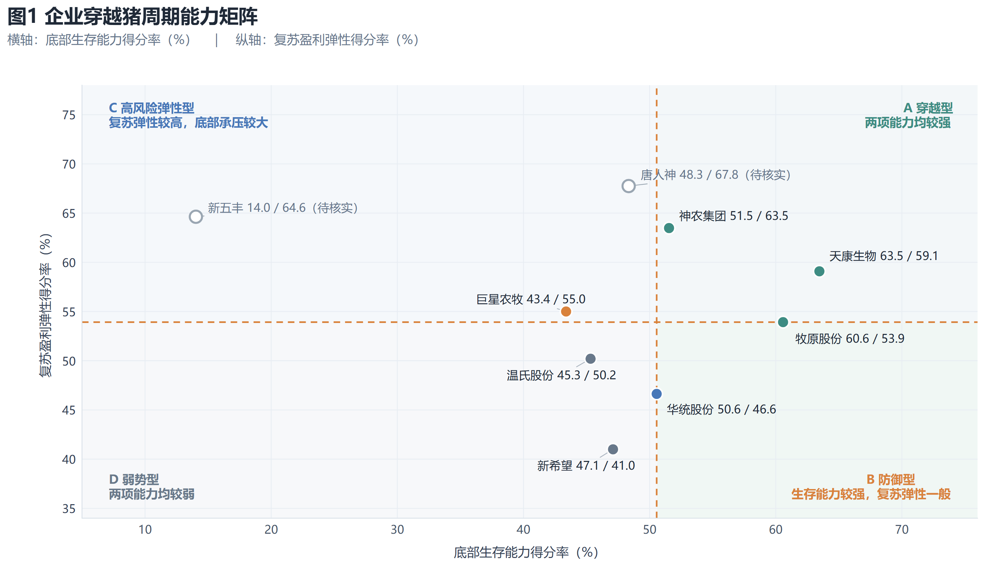

<!-- README_SYNC: source=working-tree; updated=2026-11-18 -->
<p align="center">
  简体中文 · <a href="./README_EN.md">English</a>
</p>

# A股生猪养殖企业穿越猪周期研究

猪价跌到 8.6 元/公斤时，全行业都在亏钱。但「亏钱」和「撑不住」是两件事——这份研究把**谁先倒下**和**谁能涨回来**拆开算，再用六种猪价情景压一遍。

一份可复核的 A 股生猪养殖研究：15 家公司、双维度评分、六情景压力测试，附带全部数据、方法文档和一个能直接运行的校验脚本。

> 如果这份研究对你有用，点右上角 **[Star](https://github.com/zhixunsun19-beep/pig-cycle-research/stargazers)** 收藏，方便下次回来，也让更多做周期研究的人看到。




*图 1：横轴底部生存能力，纵轴复苏盈利弹性；虚线为 7 家合格企业的中位数（生存 50.56%、弹性 53.92%），空心点为覆盖率不足 70% 的待核实企业。*

---

## 它和常见的「猪企排名」有什么不同

**1. 两个维度分开算，不合成一个总分。**
「活得下来」和「涨得上去」是两种能力。华统生存得分不低但弹性一般，巨星弹性高但底部承压——合成一个分数会把这两种风险抹平。所以最终给的是四象限，不是一个排行榜。

**2. 缺失数据不按 0 分处理。**
核心池 9 家都没有披露现金成本，所以 A2 整项**不评分**，生存维度有效满分从 60 降到 50（待核实企业 35）。宁可留空，也不让「没披露」变成「很差」或「很好」。

**3. 集团现金流不等于养猪业务现金流。**
15 家都没有分部现金流披露，所以「养猪业务现金跑道」统一标注**无法独立测算**。新希望集团跑道 40.1 个月，主要靠饲料业务撑着，不代表养猪能自持。

**4. 结论可以被一条命令复核。**
不需要装任何依赖：

```bash
git clone https://github.com/zhixunsun19-beep/pig-cycle-research.git
cd pig-cycle-research/scripts
python verify_results.py        # measured: PASS 60 / FAIL 0
```

---

## 先看结论

| 象限 | 公司（v3 综合得分） |
|---|---|
| **A 穿越型**（生存强 + 弹性强） | 天康生物 61.76 · 牧原股份 57.62 · 神农集团 56.84 |
| **B 防御型**（生存强 + 弹性弱） | 华统股份 49.02 |
| **C 高风险弹性型**（生存弱 + 弹性强） | 巨星农牧 48.54 |
| **D 弱势型**（双弱） | 温氏股份 47.49 · 新希望 44.72 |
| **待核实区**（覆盖率 <70%） | 唐人神 67% · 新五丰 59% |

三家 A 类的短板各不相同：天康的成本口径含并购主体（羌都并表）、牧原短债 706.98 亿元靠滚动续贷、神农可动用现金只有 4.21 亿元。**没有一家是干净的。**

其他几个值得看的数字：

- 基准猪价 8.60 元/公斤下，出栏增加 10% 反而扩大亏损：牧原 −26.06 亿、温氏 −14.57 亿、新希望 −6.72 亿。
- 核心池扭亏门槛 11.40–12.50 元/公斤；强势复苏情景 10.6 元/公斤下，成本最低的五家仍全部亏损。
- 2027 年可转债初始规模合计 259.0 亿元，但初始规模不等于确定偿付额——温氏余额已降到 77.06 亿元。

---

## 报告入口

| 形式 | 路径 | 说明 |
|---|---|---|
| 网页（推荐） | [`report/report.html`](report/report.html) | 单文件，10 张图内嵌，断网可读；左侧目录，移动端可用 |
| 正文源 | [`report/report.md`](report/report.md) | Markdown，便于 diff 与二次编辑 |
| 打印版 | [`report/report_print.pdf`](report/report_print.pdf) | 22 页 A4；**v6.1 早期静态快照**，未同步本次首段补充的 3 家未纳入公司，内容以 `report.md` / `report.html` 为准 |
| 速览 | [`report/report_notes.md`](report/report_notes.md) | 版本、检查范围、已知问题 |

> GitHub Pages 建议把发布源设为仓库根目录，访问 `/report/report.html`。不要只部署 `docs/`，否则 `figures/` 会断链。

---

## 快速开始

### 只验证数字（无需安装依赖）

```bash
cd scripts
python verify_results.py
```

它会核对：A2 未评分 9/9、有效满分 50/35、`final_score` 可复算且符合 cap 规则、7 家最终得分、待核实企业覆盖率与象限、阈值 50.56/53.92、六情景与关键跑道。任一不符会打印具体项并返回非零退出码。

### 重算 v3 评分（基于已发布的中间数据）

本仓库能复现的是**「用已发布的中间数据重算 v3 评分」**，不是「从原始财报端到端复现」。

- 输入（均在仓库内）：`data/processed/derived_metrics.json`（15 家三表衍生指标，28 字段/家）、`data/processed/v1_data.json`（成本/出栏/事件/估值等研究数据层）。
- 脚本：`scripts/compute_v3.py`、`scripts/research_data_v2.py`、`scripts/verify_results.py`。
- 只用标准库，无需 `pip install`；实测 Python 3.12.10。
- **上游缺口**：`scripts/compute_metrics.py` 是旧版生成器，只产出 17 字段/家，缺 `生产性生物资产_*`、`在建工程_*`、`期间费用_*`、`利润表扩展_*`、`资产负债表扩展_*` 共 11 个字段，直接用它覆盖输入会让 `compute_v3.py` 报错。完整生成器未随仓库提供，所以「原始三表 → derived_metrics」这一步不可复现。

以下命令在**仓库根目录**执行，所有产物只写到仓库外的临时目录：

```bash
REPO="$(pwd)"          # repository root
TMP="$(mktemp -d)"     # temp dir outside the repo (PowerShell: New-Item -ItemType Directory)

# 1) copy scripts and published inputs
cp "$REPO/scripts/compute_v3.py" \
   "$REPO/scripts/research_data_v2.py" \
   "$REPO/scripts/verify_results.py" "$TMP"/
cp "$REPO/data/processed/derived_metrics.json" \
   "$REPO/data/processed/v1_data.json" "$TMP"/

# 2) recompute, then verify THIS output explicitly
cd "$TMP"
python compute_v3.py
python verify_results.py --metrics v3_results.json

# 3) compare with the published baseline
sha256sum v3_results.json "$REPO/data/processed/v3_results.json"
cmp v3_results.json "$REPO/data/processed/v3_results.json" && echo "byte-identical"
```

实测（2026-11-19，Python 3.12.10）：`compute_v3.py` rc=0；`verify_results.py --metrics v3_results.json` 为 **PASS 60 / FAIL 0**，读取的是临时目录里的新产物；新产物与 `data/processed/v3_results.json` 的 SHA256 同为 `af899bc1…`，`cmp` 无差异。运行前后仓库输入、发布结果与 `figures/` 的哈希不变。

> `verify_results.py` 的默认参数指向 `../data/processed/v3_results.json`（发布件）。重算后必须加 `--metrics <本次输出>`，否则校验的是发布件，不能用来证明重算通过。

### 能复现到哪一步（如实说明）

| 环节 | 状态 | 说明 |
|---|---|---|
| v3 评分重算 | ✅ 可复现 | 基于 `derived_metrics.json` + `v1_data.json`，与发布件字节一致 |
| `derived_metrics.json` 生成 | ❌ 不可复现 | `compute_metrics.py` 为旧版（17/28 字段），完整生成器未随仓库提供 |
| 发布图表 `figures/chart_*` | ❌ 不可复现 | 源工程未随仓库提供；`build_exhibits_v3.py` 只能生成旧版 `fig_*` 自绘图，输出到 `figures_rebuilt/`，不能替代发布图表 |
| 报告 HTML 构建 | ❌ 不可复现 | 依赖未发布的 `report_v4.md`、`report_v6_final.html` |

仓库不提供 `run_all.py`。逐项说明见 [`scripts/README.md`](scripts/README.md)。

---

## 数据

| 路径 | 内容 |
|---|---|
| [`data/processed/v3_results.json`](data/processed/v3_results.json) | 评分、压力测试、弹性、四象限——**正式评分唯一来源** |
| [`data/processed/derived_metrics.json`](data/processed/derived_metrics.json) | 15 家有息负债、现金流、资本开支 |
| [`data/processed/`](data/processed/) | 9 张汇总 CSV（成本、出栏、财务、六情景、弹性、可得性、行业、负面、评分） |
| [`data/raw/`](data/raw/) | 15 家 × 8 期财报三表原始科目（公开披露数据） |
| [`data/metadata/`](data/metadata/) | 字段字典、公式、来源、期间、缺口 |

**研究样本**（固定股票池，未扩充）：

- 核心研究池 9 家：牧原 002714、温氏 300498、新希望 000876、神农 605296、天康 002100、巨星 603477、唐人神 002567、新五丰 600975、华统 002840
- 风险观察池 6 家：正邦 002157、天邦 002124、傲农 603363、京基智农 000048、东瑞 001201、大北农 002385

数据基准：财务 2026 年三季报（2026-09-30）｜行情 2026-11-13 收盘｜执行日 2026-11-15。

**引用数据前请先看这五条**：① v2 与 v3 不可混用；② 缺失不按 0；③ 12 家成本期间横跨 2026-03 至 10 月，不是同一时点排名；④ 现金流与跑道均为集团口径；⑤ 理论增量不等于盈利预测。详见 [`data/README.md`](data/README.md)。

---

## 方法与边界

```text
穿越能力 = 底部生存能力（60）× 复苏盈利弹性（40）
```

- **生存**：完全成本竞争力、现金成本、有息负债结构、现金与短债覆盖、经营现金流、2027 年到期压力。
- **弹性**：PSY/MSY、产能与出栏兑现、单位成本下降空间、猪价敏感性、管理质量。
- **六情景**：5.6 / 6.6 / 7.6 / 8.60 / 9.6 / 10.6 元/公斤。
- **跑道公式**：`货币资金 ÷ 月净现金消耗`，维持性资本开支按资本开支 50% 假设。

公式与假设：[`docs/methodology.md`](docs/methodology.md)｜[`docs/scoring_framework.md`](docs/scoring_framework.md)｜[`docs/assumptions.md`](docs/assumptions.md)

### 已知局限（不藏）

1. **现金成本缺失**：核心池 9 家全部未披露，A2 整项未评分。
2. **成本期间不一致**：12 家横跨 2026-03 至 10 月，且含代养费/并购主体差异，不能视为严格同期排名。
3. **集团口径**：无分部现金流，养猪业务跑道无法独立测算。
4. **跑道含假设**：未计续贷、授信、资产处置；未扣受限资金；维持性资本开支 50% 为假设；跑道不是破产倒计时。
5. **人工核验有限**：仅对存货、可转债合计等高价值疑点回溯原始数据，其余依赖来源标注。
6. **来源链接不全**：登记册中 6 条标注「待补充」、5 条仅登记到站点主页，均未编造具体文章 URL。

---

## 仓库结构

```text
├── report/      报告 HTML / Markdown / PDF / 阅读说明
├── figures/     10 张图（SVG 矢量 + PNG 预览）
├── data/        processed（结果）/ raw（三表）/ metadata（字典与来源）
├── scripts/     计算脚本 + requirements + 可运行校验
├── docs/        方法论、评分框架、假设、validation/
├── sources/     来源登记 S-01～S-14
└── file_inventory.md   逐文件清单与处理方式
```

完整清单见 [`file_inventory.md`](file_inventory.md)；未收录的历史版本、缓存与重复数据见 [`docs/validation/excluded_files.md`](docs/validation/excluded_files.md)。

---

## 来源与审计

- 一手：交易所定期报告（经公开接口取得原始科目）、公司公告、月度销售简报、投资者关系活动记录表、可转债募集条款。
- 官方/行业：国家统计局、农业农村部、海关总署（公开转载）。
- 二手：券商点评、财经媒体、Mysteel/卓创等监测——均标注「需核实原文」。
- 预测：机构盈利预测与猪价判断，全部标注【预测】。

来源登记：[`sources/source_register.md`](sources/source_register.md)
公开发布审计（含安全扫描与合规分类）：[`docs/validation/publication_audit.md`](docs/validation/publication_audit.md)

---

## 许可证

本仓库**未做统一开源授权**。代码、报告、财报原始科目、第三方内容的权利来源不同，不应一把 MIT 盖全部。具体边界与建议见 [`LICENSE`](LICENSE)，默认保留所有权利。

采用何种许可证、如何署名，由仓库所有者决定。

---

## 引用

引用信息见 [`CITATION.cff`](CITATION.cff)。作者与机构字段留空，未编造。

---

如果这份研究帮你省下了几天搭数据的时间，欢迎 [Star](https://github.com/zhixunsun19-beep/pig-cycle-research/stargazers) 收藏；发现问题或想补充数据，直接开 [Issue](https://github.com/zhixunsun19-beep/pig-cycle-research/issues)。
