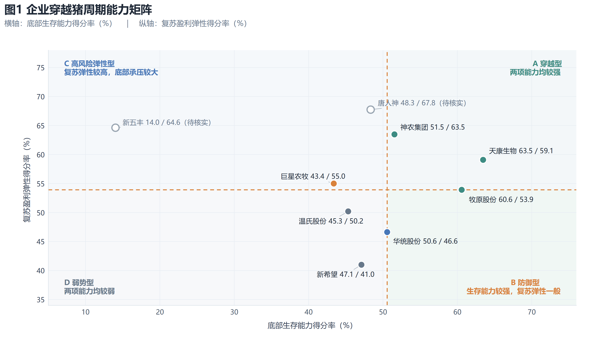

<!-- README_SYNC: source=working-tree; updated=2026-11-18 -->
<p align="center">
  <a href="./README.md">简体中文</a> · English
</p>

# Chinese Hog Producers Through the Pig Cycle

When the hog price falls to 8.6 RMB/kg, the whole industry loses money. But *losing money* and *running out of cash* are two different things. This study separates the two questions — **who survives the trough** and **who re-leverages fastest in recovery** — then stress-tests both across six price scenarios.

A reproducible research package on 15 listed A-share hog producers: two-dimension scoring, six-scenario stress tests, full data, methodology notes, and a verification script that runs without installing anything.

> If this is useful, **[star the repo](https://github.com/zhixunsun19-beep/pig-cycle-research/stargazers)** so you can find it again — and help other people doing cycle research find it too.




*Figure 1: x-axis = downside survival score, y-axis = recovery elasticity score. Dashed lines are the medians of the 7 eligible companies (survival 50.56%, elasticity 53.92%). Hollow markers are companies below the 70% data-coverage threshold.*

---

## Why this is not another "hog stock ranking"

**1. Two scores, not one composite.**
Surviving a trough and out-earning peers in a recovery are different capabilities. Huatong scores reasonably on survival but is middling on elasticity; Giant Star is the reverse. Collapsing them into a single number hides exactly the trade-off investors need to see. The output is a quadrant, not a leaderboard.

**2. Missing data is never scored as zero.**
None of the 9 core companies disclose a cash cost. Rather than imputing one, the cash-cost item (A2) is left **unscored**, and the survival dimension's effective maximum drops from 60 to 50 (35 for the pending-review companies). "Not disclosed" must not silently become "bad" or "good".

**3. Group cash flow ≠ hog-segment cash flow.**
No company discloses segment-level cash flow. The "hog-segment runway" is therefore labelled **not independently measurable**. New Hope's group runway of 40.1 months is largely carried by its feed business (74.55% of revenue) — that says nothing about the hog operation standing on its own.

**4. Every headline number is checkable with one command.**
No dependencies required:

```bash
git clone https://github.com/zhixunsun19-beep/pig-cycle-research.git
cd pig-cycle-research/scripts
python verify_results.py        # measured: PASS 60 / FAIL 0
```

---

## Headline results

| Quadrant | Companies (v3 composite score) |
|---|---|
| **A — Through-cycle** (strong survival + strong elasticity) | Tiankang 61.76 · Muyuan 57.62 · Shennong 56.84 |
| **B — Defensive** (strong survival + weak elasticity) | Huatong 49.02 |
| **C — High-beta, high-risk** (weak survival + strong elasticity) | Giant Star 48.54 |
| **D — Weak on both** | Wens 47.49 · New Hope 44.72 |
| **Pending review** (coverage < 70%) | Tangrenshen 67% · Xinwufeng 59% |

The three A-class names have three different flaws: Tiankang's cost basis includes an acquired entity (Qiangdu), Muyuan carries RMB 70.7bn of short-term interest-bearing debt rolled over continuously, and Shennong has only RMB 421m of usable cash. **None of them is clean.**

Other numbers worth noting:

- At the 8.60 RMB/kg base price, adding 10% output *widens* losses: Muyuan −2.61bn, Wens −1.46bn, New Hope −0.67bn (RMB).
- The break-even band for the core pool is 11.40–12.50 RMB/kg. Even at 10.6 RMB/kg, the five lowest-cost producers all remain loss-making.
- Convertible bonds maturing around 2027 total RMB 25.9bn at issuance — but issuance size is not the cash repayment obligation (Wens' outstanding balance is already down to RMB 7.71bn).

---

## Read the report

| Format | Path | Notes |
|---|---|---|
| Web (recommended) | [`report/report.html`](report/report.html) | Single file, 10 charts embedded, works offline |
| Markdown source | [`report/report.md`](report/report.md) | Diff-friendly, editable |
| Print | [`report/report_print.pdf`](report/report_print.pdf) | 22 pages, A4; **early v6.1 static snapshot**, does not include the 3 excluded companies added to the opening paragraph — `report.md` / `report.html` are authoritative |
| Reader's notes | [`report/report_notes.md`](report/report_notes.md) | Version, scope of checks, known issues |

> For GitHub Pages, set the source to the repository root and open `/report/report.html`. Do not publish only `docs/` — `figures/` would break.

---

## Quick start

### Verify the numbers (no install)

```bash
cd scripts
python verify_results.py
```

It checks: A2 unscored for 9/9, effective maxima 50/35, `final_score` recomputable and consistent with the cap rule, the 7 published scores, coverage and quadrant labels of the pending-review names, thresholds 50.56/53.92, six scenarios, and key runway values. Any mismatch prints the failing item and exits non-zero.

### Recompute the v3 score (from published intermediate data)

What this repository reproduces is **recomputing the v3 score from the published intermediate data** — not an end-to-end rebuild from the raw financial statements.

- Inputs (both in this repo): `data/processed/derived_metrics.json` (15 companies, 28 fields each) and `data/processed/v1_data.json` (cost/output/events/valuation research layer).
- Scripts: `scripts/compute_v3.py`, `scripts/research_data_v2.py`, `scripts/verify_results.py`.
- Standard library only — no `pip install`; measured on Python 3.12.10.
- **Upstream gap**: `scripts/compute_metrics.py` is a legacy generator producing only 17 fields per company. It lacks 11 fields (`生产性生物资产_*`, `在建工程_*`, `期间费用_*`, `利润表扩展_*`, `资产负债表扩展_*`), so overwriting the input with its output makes `compute_v3.py` fail. The complete generator is not included, so "raw statements → derived_metrics" cannot be reproduced.

Run the following from the **repository root**; all outputs go to a temporary directory outside the repo:

```bash
REPO="$(pwd)"          # repository root
TMP="$(mktemp -d)"     # temp dir outside the repo (PowerShell: New-Item -ItemType Directory)

# 1) copy scripts and published inputs
cp "$REPO/scripts/compute_v3.py" \
   "$REPO/scripts/research_data_v2.py" \
   "$REPO/scripts/verify_results.py" "$TMP"/
cp "$REPO/data/processed/derived_metrics.json" \
   "$REPO/data/processed/v1_data.json" "$TMP"/

# 2) recompute, then verify THIS output explicitly
cd "$TMP"
python compute_v3.py
python verify_results.py --metrics v3_results.json

# 3) compare with the published baseline
sha256sum v3_results.json "$REPO/data/processed/v3_results.json"
cmp v3_results.json "$REPO/data/processed/v3_results.json" && echo "byte-identical"
```

Measured (2026-11-19, Python 3.12.10): `compute_v3.py` rc=0; `verify_results.py --metrics v3_results.json` reports **PASS 60 / FAIL 0** against the freshly written file; its SHA256 equals the published `data/processed/v3_results.json` (`af899bc1…`) and `cmp` reports no difference. Hashes of repo inputs, published results and `figures/` are unchanged before and after.

> `verify_results.py` defaults to `../data/processed/v3_results.json` (the published file). After recomputing you must pass `--metrics <this run's output>`, otherwise it validates the published file and cannot prove the recomputation passed.

### How far reproducibility goes (honest scope)

| Stage | Status | Note |
|---|---|---|
| v3 score recompute | ✅ Reproducible | From `derived_metrics.json` + `v1_data.json`; byte-identical to the published result |
| `derived_metrics.json` generation | ❌ Not reproducible | `compute_metrics.py` is legacy (17/28 fields); the complete generator is not included |
| Published charts `figures/chart_*` | ❌ Not reproducible | Source project not included; `build_exhibits_v3.py` only regenerates the legacy `fig_*` set into `figures_rebuilt/` and cannot replace the published charts |
| Report HTML build | ❌ Not reproducible | Depends on unpublished `report_v4.md`, `report_v6_final.html` |

There is no `run_all.py`. Details in [`scripts/README.md`](scripts/README.md).

---

## Data

| Path | Contents |
|---|---|
| [`data/processed/v3_results.json`](data/processed/v3_results.json) | Scores, stress tests, elasticity, quadrants — **single source of truth** |
| [`data/processed/derived_metrics.json`](data/processed/derived_metrics.json) | Interest-bearing debt, cash flow, capex for 15 companies |
| [`data/processed/`](data/processed/) | 9 summary CSVs (cost, output, financial safety, scenarios, elasticity, availability, industry, events, scores) |
| [`data/raw/`](data/raw/) | Raw line items from 8 reporting periods × 15 companies |
| [`data/metadata/`](data/metadata/) | Data dictionary, formulas, sources, periods, gaps |

**Sample** (fixed universe, not expanded):

- Core pool (9): Muyuan 002714, Wens 300498, New Hope 000876, Shennong 605296, Tiankang 002100, Giant Star 603477, Tangrenshen 002567, Xinwufeng 600975, Huatong 002840
- Risk watchlist (6): Zhengbang 002157, Tianbang 002124, Aonong 603363, Kingkey Zhinong 000048, Dongrui 001201, Dabeinong 002385

Basis: 2026 Q3 financials (2026-09-30) · market close 2026-11-13 · study date 2026-11-15.

**Five rules before you quote any number**: (1) v2 and v3 scores are not comparable; (2) missing values are never zero; (3) cost disclosure periods span March–October 2026, so it is not a same-date ranking; (4) cash flow and runway are group-level; (5) theoretical sensitivity is not an earnings forecast. See [`data/README.md`](data/README.md).

---

## Method and limits

```text
Through-cycle capability = Downside survival (60) × Recovery elasticity (40)
```

- **Survival**: full cost competitiveness, cash cost, debt structure, cash vs. short-term debt, operating cash flow, 2027 maturities.
- **Elasticity**: PSY/MSY, capacity delivery, room for unit-cost reduction, price sensitivity, management quality.
- **Six scenarios**: 5.6 / 6.6 / 7.6 / 8.60 / 9.6 / 10.6 RMB/kg.
- **Runway**: `cash ÷ monthly net cash burn`, with maintenance capex assumed at 50% of total capex.

Formulas and assumptions: [`docs/methodology.md`](docs/methodology.md) · [`docs/scoring_framework.md`](docs/scoring_framework.md) · [`docs/assumptions.md`](docs/assumptions.md)

### Known limitations

1. **No cash cost** for any of the 9 core companies — the A2 item is unscored.
2. **Inconsistent cost periods** (March–October 2026) and different inclusions (contract farming fees, acquired entities) — not a strict same-date comparison.
3. **Group-level only** — no segment cash flow, so the hog-segment runway is not measurable.
4. **Runway relies on assumptions** — no refinancing, credit lines, asset sales, or government support modelled; restricted cash not deducted; 50% maintenance capex assumed. It is a ranking tool, not a bankruptcy countdown.
5. **Limited manual verification** — only high-value doubts (inventory, convertible-bond totals) were traced to source; the rest relies on source annotations.
6. **Incomplete source URLs** — 6 entries marked "to be added" and 5 registered only at a site homepage; no article URLs were invented. Reachability of an endpoint does not mean the original text was verified.

---

## Repository layout

```text
├── report/      HTML / Markdown / PDF / reader notes
├── figures/     10 charts (vector SVG + PNG preview)
├── data/        processed results / raw statements / metadata
├── scripts/     computation + requirements + runnable verification
├── docs/        methodology, scoring framework, assumptions, validation/
├── sources/     source register S-01…S-14
└── file_inventory.md   per-file inventory and disposition
```

Full inventory: [`file_inventory.md`](file_inventory.md). Excluded historical versions, caches and duplicates: [`docs/validation/excluded_files.md`](docs/validation/excluded_files.md).

---

## Sources and audit

- Primary: exchange filings (raw line items via a public financial API), company announcements, monthly sales briefings, investor-relations records, convertible-bond prospectuses.
- Official/industry: National Bureau of Statistics, MARA, Customs (via public reprints).
- Secondary: broker notes, financial media, Mysteel/SCI monitoring — all flagged "verify against the original".
- Forecasts: analyst estimates and price calls, always labelled as forecasts.

Source register: [`sources/source_register.md`](sources/source_register.md)
Publication audit (security scan + compliance classification): [`docs/validation/publication_audit.md`](docs/validation/publication_audit.md)

---

## License

This repository is **not released under a single open-source license**. Code, the report, raw financial line items and third-party material have different rights holders and different redistribution boundaries. See [`LICENSE`](LICENSE) for the exact scope; all rights are reserved by default.

The license choice and attribution are up to the repository owner.

---

## Citation

See [`CITATION.cff`](CITATION.cff). Author and affiliation fields are intentionally left blank rather than invented.

---

If this saved you a few days of data assembly, a [star](https://github.com/zhixunsun19-beep/pig-cycle-research/stargazers) is appreciated. Found a bug or have better data? Open an [issue](https://github.com/zhixunsun19-beep/pig-cycle-research/issues).
