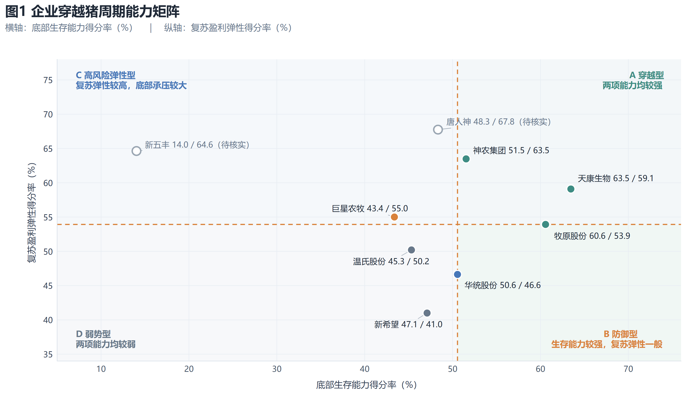
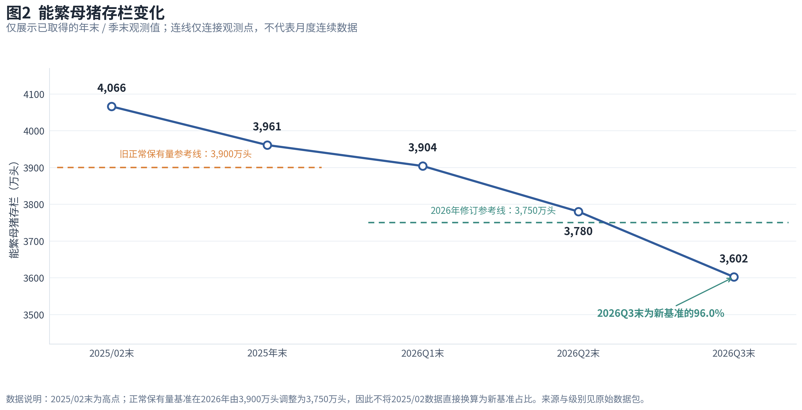
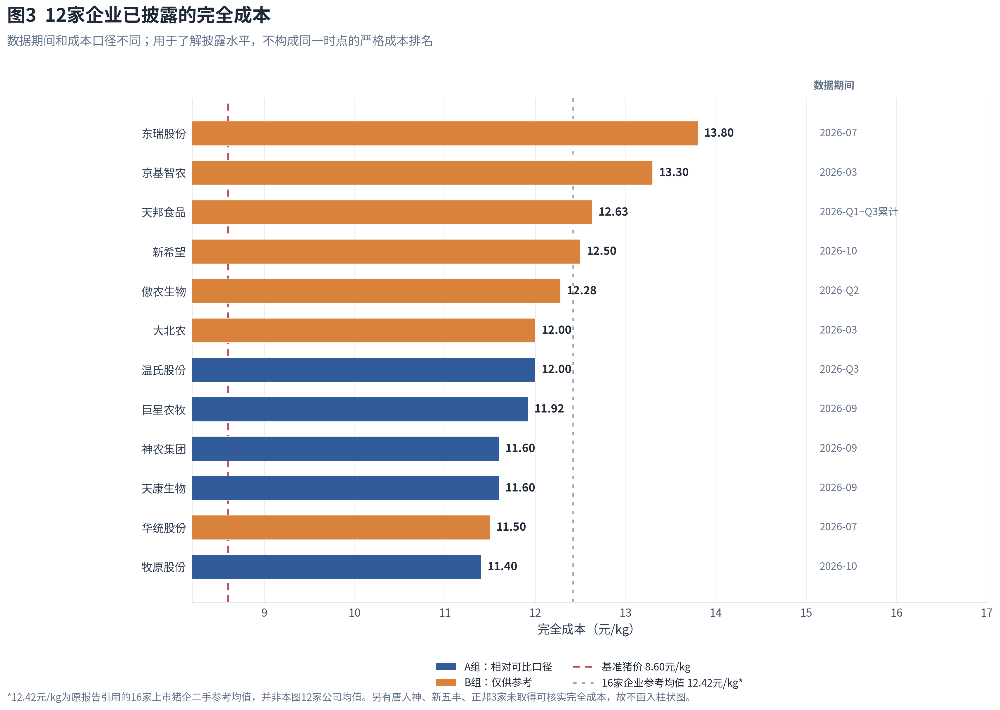
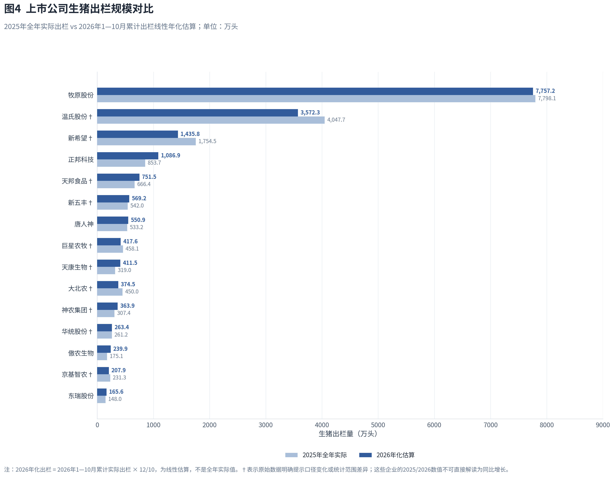
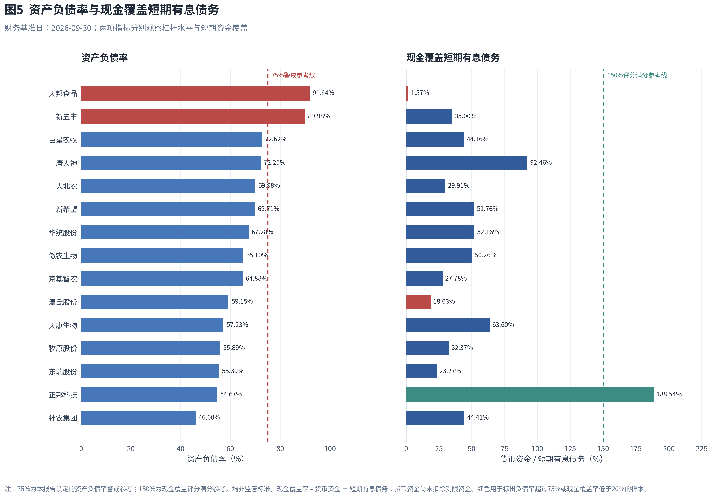
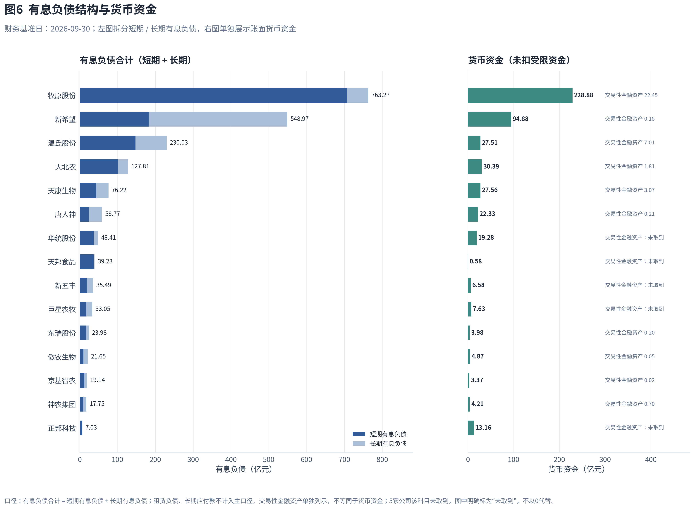
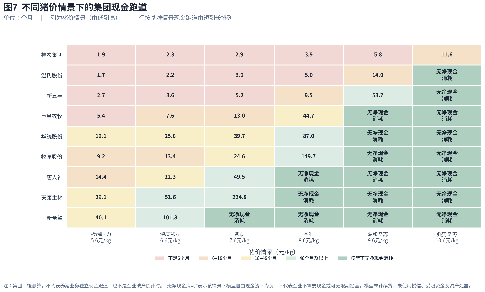
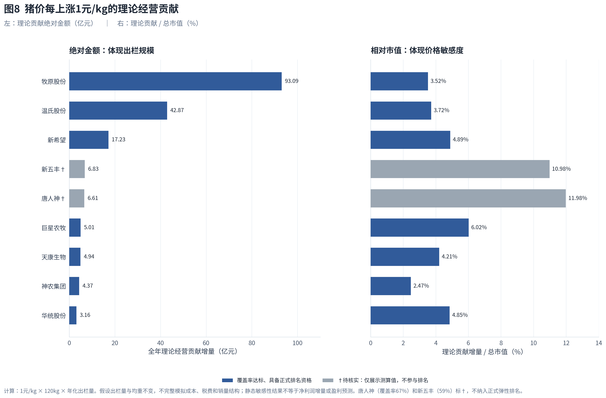
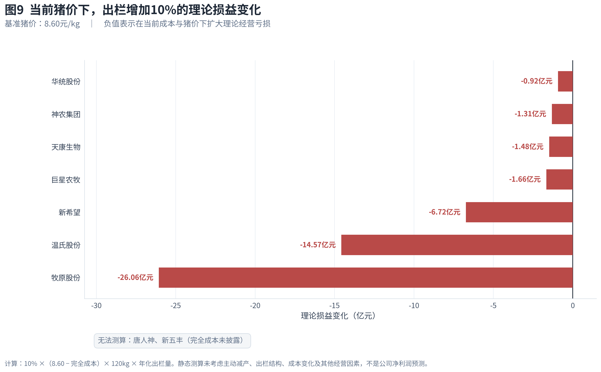
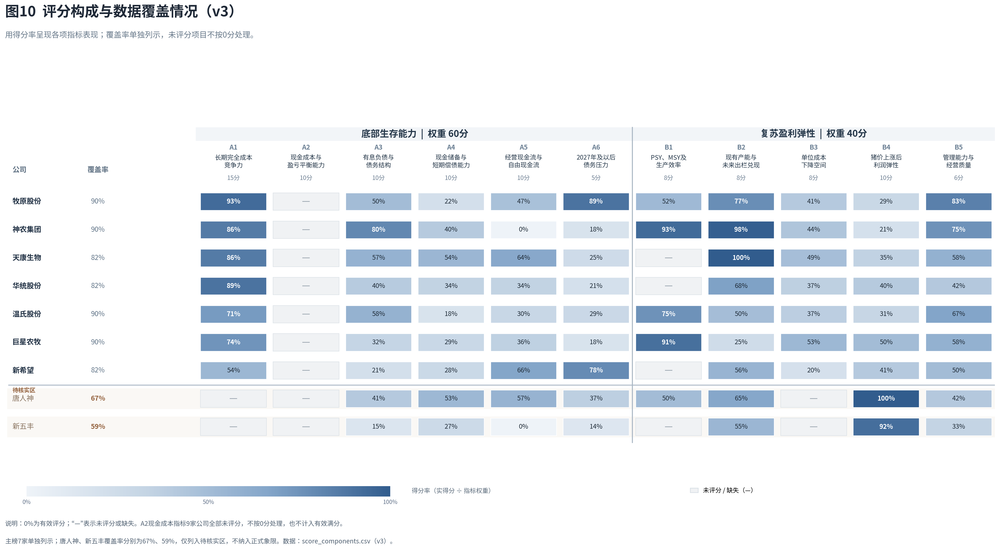

# A 股生猪养殖企业穿越周期研究

底部生存能力与复苏盈利弹性：15 家上市公司比较（2026 年 11 月）

本报告的研究主题由委托方指定：寻找行业进入低谷时不容易倒下、行业复苏时又能率先释放利润的 A 股生猪养殖企业，以底部生存能力 × 复苏盈利弹性作为最高判断标准，两个维度分别衡量，不合并为一条排名。股票池固定为 15 家【用户提供】：核心研究池 9 家、风险观察池 6 家，另有 3 家本轮不纳入。

执行日 2026-11-15，行情基准为 2026-11-13 收盘；财务基准为 2026 年三季报（2026-09-30，15 家一手财报三表）。研究版本 v3.0（2026-11-16）。本版只做文字编辑与页面呈现优化，未改动研究数据与结论。

> **关于数据与校验范围**：全部数字来自委托方研究数据包（`outputs/pig_research_v2_20261115/`），撰写方未重新采集数据、未改写研究结论；模型修订记录见第 10 章与 `data-issues/`。计算脚本校验 62/62 项通过、结构校验通过，但该校验仅代表纳入脚本的计算与格式检查，**不包含**人工事实核对、原始来源审查、HTML 资源完整性与来源链接的全面审计——各类检查状态见 `quality-review.md`。

## 第1章 执行摘要

本章用一页篇幅交代行业所处位置、主要结论、重点公司、最大风险与数据限制。详细推导放在后续各章，附录可供复核。

行业仍处在亏损最深的阶段。基准猪价 8.60 元/公斤（2026-11-13 外三元市场均价）为近十年新低，自繁自养头均亏 384.27 元、连亏约 49 周【二手·Mysteel/长江证券】；能繁母猪 2026Q3 末 3602 万头、同比 −10.7%【官方·转载】。存栏在去（−2.6%），猪肉产量却仍在增加（+3.2%），母猪去化的效果被 PSY 提升与 126 公斤出栏均重对冲，因此本报告以深度磨底作为基准情形，尚未进入复苏阶段。

12 家可核实的完全成本（11.40–13.80 元/公斤）全部高于现货猪价，行业当期没有赢家。按底部生存能力与复苏盈利弹性两个维度的得分率划分后，正式四象限中进入穿越型（A 类）的有 3 家：天康生物、牧原股份、神农集团。三家公司均存在需要关注的风险，现有数据只能反映其相对抗风险能力：天康生物的 11.60 元/公斤是含并购的合并口径，牧原股份 706.98 亿元短期有息依赖滚动续贷，神农集团可动用货币资金仅 4.21 亿元。

有三组数据值得单独列出。神农集团资产负债率 46.00% 为全池最低，但流动资产 27.27 亿元中 17.40 亿元是存货，可动用货币资金只有 4.21 亿元，负债率低并不等于手上有钱。在完全成本高于猪价的情况下，增加出栏量可能进一步扩大亏损：按基准价测算，出栏增加 10% 时牧原股份约 −26.06 亿元、温氏股份约 −14.57 亿元。新希望饲料业务占收入 74.55%，其极端压力情景下 40.1 个月的集团现金跑道主要由饲料板块提供支撑，不能据此判断养猪业务自身可以持续经营同样长时间。

正式四象限的分层结果：穿越型 A 类为天康生物、牧原股份、神农集团；防御型 B 类为华统股份；高风险弹性型 C 类为巨星农牧；弱势型 D 类为温氏股份、新希望。唐人神与新五丰的数据覆盖率分别为 67%、59%，低于 70% 的门槛，进入待核实区，不参与正式排名与四象限，也不用于计算象限阈值。

需要重点跟踪的风险有三项。2027 年三笔可转债集中到期，初始发行规模合计 259.0 亿元；此前引用的「270.02 亿元合计」与明细加总不符，已弃用并登记为数据冲突（见第 5 章）。冬季疫病与冻品库容率约 32% 的高位，可能带来集中出栏压力。此外，本报告的完全成本数据主要来自投资者关系活动记录表与互动平台答复，未经审计。

财务数字来自一手三表，成本与出栏以公司互动平台和调研纪要为主【一手·未审计】，行业供需以官方转载与咨询机构数据为主【二手】，2027 年猪价判断全部为机构预测【预测】。现金跑道模型未计入续贷、未使用授信与受限资金。现金成本方面，15 家中仅 3 家有读数，且仅东瑞股份为一手口径；核心池 9 家因未披露一手现金成本，A2 项整项未评分，生存维度的有效满分由 60 分降至 50 分。完整缺口清单见第 9、10 章。

## 第2章 研究框架：底部生存能力与复苏盈利弹性

本章说明为什么把企业放在两个维度上分别衡量，以及这两个维度各自对应哪些财务事实。研究报告常见的一个简化是把成本最低直接等同于最安全，但本项目的数据并不支持这种对应关系。

成本优势与偿债能力并不一致。成本最低的牧原股份，短期有息 706.98 亿元，货币资金覆盖短期有息的比例仅 32.37%【一手·测算】，短期借款主要依靠滚动续贷维持；单位市值弹性读数最高的唐人神（11.98%）则恰好是覆盖率 67%、完全成本未披露的待核实区企业，该读数不作为有效弹性结论。把成本、现金和出栏弹性压成一条总排名，会同时丢掉这两类信息，因此本报告用两张轴分别呈现。

本轮模型修订的出发点，是把三个容易被合并的问题分开：

| 问题 | 指标 | 口径 |
|---|---|---|
| ① 卖一头猪账面上亏多少钱 | A1 完全成本竞争力 | 完全成本 − 基准猪价 |
| ② 卖一头猪实际消耗多少现金 | A2 现金成本竞争力 | 现金成本 − 基准猪价（仅一手披露评分） |
| ③ 持续亏损时是否有足够现金继续经营 | A4 现金短债 + A5 经营现金流 + 现金跑道 | 一手三表 + 情景测算 |

先明确几个术语。完全成本指养一公斤生猪从生产到出栏承担的全部成本，包含折旧、管理费用和财务费用；现金成本指继续养猪时实际需要支付的现金，不含折旧这类非现金项目；现金跑道则是按当前资金消耗速度，企业现有资金理论上还能支撑多久，它是模型情景结果，不等于破产倒计时。后文使用这些术语时不再重复解释。

本报告采用双维度评价框架：底部生存能力与复苏盈利弹性。正式四象限按照底部生存能力综合得分率与复苏盈利弹性得分率划分，阈值取 7 家合格企业的中位数。集团现金跑道作为独立的情景压力测试，用于辅助判断企业的现金承受能力，不直接作为图1横轴或象限划分阈值。现金储备较弱的企业，可能在猪价回升前就面临较大的资金压力，此时讨论其复苏弹性意义有限。




**图1　企业穿越猪周期能力矩阵：A 类（穿越型）为天康、牧原、神农**

> Notes: x = 底部生存能力得分率（60 分制）、y = 复苏盈利弹性得分率（40 分制）；虚线阈值 = **仅由 7 家合格企业（覆盖率≥70% 且无风险上限）的中位数**决定（生存 50.56 / 弹性 53.92）。空心圆 = 待核实区（覆盖率<70%），不参与阈值计算、不获得正式象限。牧原弹性得分率 53.92 与华统生存得分率 50.56 恰好等于各自中位数（边界点），排名对阈值敏感，解读时需注意。  
> Sources: v3_results.json（quadrants）【测算】；权重为用户研究规格 60/40。

四个象限的含义如下：A 穿越型指底部生存与复苏弹性都较强，是优先研究的对象；B 防御型底部相对安全、弹性一般；C 高风险弹性型弹性高但底部抗风险能力弱；D 弱势型两个维度均不足。温氏股份落入 D 类是评分模型的输出结果，主要原因是现金覆盖率仅 18.63%、经营现金流转负，叠加 A2 重构后的阈值修正，并非主观调低，具体对比见第 8 章。
## 第3章 行业周期与供需

判断周期位置是后续所有企业比较的前提。本章先给出当前猪价与养殖盈亏，再梳理过去五轮周期的时长与高低点，最后说明为什么产能去化尚未带来供给收缩。

基准猪价取 8.60 元/公斤（2026-11-13 外三元市场均价，多源区间 8.54–8.76【二手】）。媒体转引的 11.83 元/公斤与官方 9 月出场价 11.05 元/公斤，与当期亏损量级不自洽，已并列标为存疑，冲突处理见第 10 章。自繁自养头均亏 384.27 元【二手·Mysteel 2026-11-11】。



**图2　能繁母猪连续四个季度去化，Q3 末降至正常保有量的 96.0%**

> Notes: 单位：万头；报告期 2025/02–2026Q3 各期末；96.0% = 3602 ÷ 3750（2026 年修订的正常保有量）。  
> Sources: 五部委/国家统计局（官方·转载）；中国养猪网（二手）。

| 轮次 | 起止 | 时长 | 高点（元/kg） | 低点（元/kg） |
|---|---|---|---|---|
| 第1轮 | 2006/07–2010/06 | 约47个月 | 17.45（2008/03） | 约9.7（2010/05） |
| 第2轮 | 2010/06–2014/04 | 约46个月 | 19.92（2011/09） | 10.45（2014/04） |
| 第3轮 | 2014/04–2018/05 | 约49个月 | 21.12（2016/06） | 10.01（2018/05） |
| 第4轮 超级周期 | 2018/05–2022/04 | 约48个月 | 40.98（2019/11） | 12.12（2022/03） |
| 第5轮 本轮 | 2022/04–至今 | 下行约41个月、谷底约21个月 | 2022 高27.1 / 2024 反弹16–18 | 2026-11 8.5–8.8（近十年新低） |

> Sources: 前 4 轮来自今报在线/立鼎/新浪/中国养猪网【二手】；本轮来自长江证券/证券时报/Mysteel【二手】。Notes: 起止与高低点存在 1–2 个月差异，已并列未择一。
上一轮 2018/08–2019/09 的能繁母猪去化达 39.1%（3145→1913 万头），此后出现 40.98 元/公斤的历史高点。本轮自 2025/02 高点 4066 万头至今去化约 11.4%–11.7%【二手】，不足上一轮的三分之一。去化幅度有限而效率提升持续，磨底期因此可能拉长，这也是本报告设定温和复苏情景的依据。

近一个报告期的供需读数如下，其中官方口径与咨询机构监测分开标注。

| 指标 | 数值 | 报告期 | 来源 |
|---|---|---|---|
| 生猪存栏 | 42533万头 | 2026Q3末 | 五部委（官方·转载） |
| 生猪出栏 | 53739万头 | 2026前三季度 | 五部委（官方·转载） |
| 猪肉产量 | 4508万吨 | 2026前三季度 | 五部委（官方·转载） |
| 猪肉产量 | 5938万吨（历史新高） | 2025全年 | 中国经济网（媒体·二手） |
| 定点屠宰量 | 3986万头 | 2026/09 | 五部委（官方·转载） |
| 定点屠宰量 | 3755万头 | 2026/08 | 五部委（官方·转载） |
| 猪肉进口 | 56.48万吨 | 2026/1-9 | 海关总署（官方·转载） |
| 冻品库容率 | 约31.6%–32% | 2026/11 | 新浪/猪易通/中华网（媒体·二手） |
| 出栏均重 | 126kg | 2026/11/13 | 卓创/Mysteel（咨询·二手） |
| 新生仔猪 | 9月环比−0.52% | 2026/09 | 涌益样本（咨询·二手，非全国） |
| 二次育肥 | 仅取到成本 | 2026/11/11 | Mysteel（咨询·二手） |
| 猪肉消费占比 | 62.1%(2018)→57.9%(2025) | 2025 | 证券时报转发改委口径（媒体·二手） |

能繁母猪去化传导到商品猪供给通常需要 10–13 个月，2026Q3 的去化主要在 2027 年中至下半年兑现。与此同时，PSY 提升（头部企业接近 30）、126 公斤出栏均重与二次育肥压栏都在增加实际供给。机构对 2026 年 11–12 月的共识是弱反弹至 9.8–10.1 元/公斤、仍难以突破完全成本线【预测·机构】；官方背景专家的表述是「温和回升但大幅上涨基础不具备」【预测·二手】。本报告的六档猪价情景据此以温和复苏为中枢设计。
## 第4章 成本与竞争格局

成本是底部生存能力的基础，但公开披露的口径并不统一。本章先列出 12 家可核实的完全成本及其数据期间，再讨论现金成本的可得性、成本改善的原因，以及出栏规模与成本之间的关系。

下表汇总的是各公司目前能够核实的公开成本数据。数据期间存在差异，覆盖 2026 年 3 月、7 月、Q2、Q1–Q3 累计、9 月、10 月等不同时点，因此主要用于观察成本水平与历史竞争力，不代表所有公司在同一时点的实际成本排名；横向可比性已在分组列逐家标注。

| 公司 | 代码 | 分组 | 完全成本(元/kg) | 数据期间 | 成本统计口径 | 数据来源 | 横向可比性 |
|---|---|---|---:|---|---|---|---|
| 牧原股份 | 002714 | A组 | 11.40 | 2026-10 | 生猪养殖完全成本（含折旧摊销等全部成本） | 投资者互动平台答复 2026-11-09（金融界/网易转载） | 可比（注意合并口径） |
| 华统股份 | 002840 | B组 | 11.50 | 2026-07 | 生猪养殖完全成本（互动易口径） | 深交所互动易 2026-07；策略会转录 2026-03-02（Reportify，非正式公告） | 仅参考（口径/时点存疑） |
| 神农集团 | 605296 | A组 | 11.60 | 2026-09 | 生猪养殖完全成本 | 投资者关系活动记录表 2026-10-28（上证e互动/新华财经） | 可比（注意合并口径） |
| 天康生物 | 002100 | A组 | 11.60 | 2026-09 | 生猪养殖完全成本（合并口径，含天康本部+羌都畜牧） | 投资者关系活动记录表 2026-10-29（8家机构调研，同花顺转载） | 可比（注意合并口径） |
| 巨星农牧 | 603477 | A组 | 11.92 | 2026-09 | 商品肥猪完全成本 5.96元/斤 ×2 折算（仅肥猪环节） | 投资者关系活动记录表 2026-10-30（上证e互动/新华财经） | 可比（注意合并口径） |
| 温氏股份 | 300498 | A组 | 12.00 | 2026-Q3 | 肉猪养殖综合成本（含代养费；Q3账面约12.2，剔除肉猪跌价准备后约12.0） | 2026三季报 + 8月经营数据 + 机构纪要（券商点评，非一手） | 可比（注意合并口径） |
| 大北农 | 002385 | B组 | 12.00 | 2026-03 | 控股单位育肥猪完全成本（约 12；Q3 略低于 12.0 为二手） | 深交所互动易 2026-03；中报点评 2026-08（非一手） | 仅参考（口径/时点存疑） |
| 傲农生物 | 603363 | B组 | 12.28 | 2026-Q2 | 育肥完全成本（Q1 12.83→Q2 12.28） | 投资者关系活动记录表 2026-04/05（巨潮）；2026-10  | 仅参考（口径/时点存疑） |
| 新希望 | 000876 | B组 | 12.50 | 2026-10 | 正常运营场线出栏肥猪成本（10月） | 投资者互动平台（财联社转载） | 仅参考（口径/时点存疑） |
| 天邦食品 | 002124 | B组 | 12.63 | 2026-Q1~Q3累计 | 育肥猪全成本（前三季度累计平均，非单月） | 2026三季报 / 北京商报 2026-11-10（媒体转述，非一手） | 仅参考（口径/时点存疑） |
| 京基智农 | 000048 | B组 | 13.30 | 2026-03 | 生猪养殖完全成本（3月单月） | 2025年度业绩说明会 2026-04-30（财联社） | 仅参考（口径/时点存疑） |
| 东瑞股份 | 001201 | B组 | 13.80 | 2026-07 | 商品猪完全成本（7月单月）；代养 13.26；前三季度付现成本 12.65 | 投资者调研 2026-08-28 / 财联社 2026-10-27 | 仅参考（口径/时点存疑） |

> Sources: 公司互动平台/调研纪要【一手·未审计】与券商点评/媒体【二手·需核实原文】，逐家级别见表内来源列。Notes: 唐人神（仅目标 12.6）、新五丰（仅同比 −8%）、正邦（两口径差 7.2 无法消解）成本无法核实，不入表不排名。
两个成本区间对应不同的样本范围，需要分开理解。12 家全样本（含风险观察池）的完全成本区间是 11.40–13.80 元/公斤；核心研究池中有成本读数的 7 家，区间是 11.40–12.50 元/公斤。此前报告部分结论中的「扭亏门槛 11.4–12.5 元/公斤」采用的是核心池口径，因为全部情景测算只在核心池进行，本报告沿用该口径并在此说明。盈亏平衡猪价等于完全成本，因为该口径已包含折旧、期间费用与财务费用。



**图3　12 家可核实完全成本全部高于基准猪价——数据期间不同，不能当作同一时点排名**

> Notes: 单位：元/公斤。标签含数据期间；A 组（深蓝）＝可比完全成本口径，B 组（橙）＝口径/时点存疑仅参考。红虚线＝基准猪价 8.60；灰虚线＝16 家上市猪企 2026 均值约 12.42（二手）。  
> Sources: research_data_v2.COST【一手/二手逐家标注】。

现金成本的可得性明显差于完全成本。15 家中仅 3 家有读数：东瑞股份付现成本 12.65 元/公斤【一手·调研】、华统股份现金成本约 11.0 元/公斤（策略会转录，二手，养殖成本口径）、牧原股份约 10.3 元/公斤（媒体转述，待核实）。这三家的数值较低更多反映披露口径不透明，而非可比的现金成本优势。v3 评分中 A2（现金成本竞争力）只对一手口径评分，核心池 9 家因此整项未评分。

成本改善的来源需要谨慎判断。同期玉米价格同比上涨 4.34%、豆粕价格同比下降 3.96%，而部分头部企业仍实现连续降本（神农集团 21 个月累计 −1.4、牧原股份年内 −0.6、天康生物 −0.68、巨星农牧 −0.68 元/公斤【一手】）。在玉米价格上涨、豆粕价格下降的背景下，这些企业的持续降本不能简单归因于饲料原材料整体降价，生产效率与养殖管理改善可能是重要来源。但企业级成本分项披露不足（仅新希望披露过一次半年度拆分），尚无法精确分解各因素的贡献；采购时点与价格、饲料配方、仔猪成本、猪群结构、出栏均重以及统计口径变更，都是未加控制的因素。



**图4　出栏规模与增速：正邦、傲农在重整恢复中逆势放量**

> Notes: 单位：万头。2026 年化 = 26M1-10 累计 × 12/10 线性年化；温氏 2025 含仔猪/2026 剔除仔猪、新希望生猪→商品猪、大北农控股商品肥猪，口径变更不可直接同比；华统 26M1-10 为月度简报累加推算。  
> Sources: 公司月度销售简报/公告【一手】与华安/招商周报【二手·需核实原文】。

出栏增长的性质并不相同，大致可分为三类：牧原、神农属于母猪产能保全型；正邦（2025 年实际出栏 853.69 万头，2026 年 1—10 月累计 905.75 万头线性年化 1086.9 万头，年化增幅约 27.3%，为线性估算、非全年实际同比、未计季节性）、傲农（存栏 +51%）属于重整恢复型；新希望、大北农、唐人神则更多依靠饲料业务提供资金。三类扩张在复苏期转化为利润的质量不同，不能只看增速。多元化公司的分部拆分见 `v2_股票池核验与出栏量_15家.csv`：饲料板块分别占新希望 74.55%、大北农 68.84%、唐人神 69.00% 的收入，因此集团利润与现金流不能归因于养猪业务。
## 第5章 财务状况与债务压力

企业的偿债能力不能只看资产负债率。对于处于持续亏损期的生猪养殖企业，现金储备、短期债务和经营现金流同样重要，本章按这一顺序逐项核对，并单独讨论 2027 年到期的可转债。

本章会用到几个术语：资产负债率指企业资产中来自借款等负债的比例；经营现金流是日常经营活动真正带来的现金净额；资本开支是建设、更新和维护生产设施投入的资金；转股价值指可转债按当前股价转换为股票后对应的价值。




**图5　低资产负债率并不意味着低流动性风险**

> Notes: 单位：%。左图红线 75% 为警戒参考；右图 150% 为评分满分参照。现金覆盖率＝货币资金 ÷ 短期有息，未扣受限资金（附注未取到）→ 偏乐观。  
> Sources: 新浪财经财报三表【一手，2026-09-30】；覆盖率为自行测算。

神农集团是一个需要拆开看资产负债表的例子。其资产负债率 46.00% 为全池最低，但流动资产 27.27 亿元中，存货占 17.40 亿元。存货不等同于可自由支配的偿债现金，实际流动性还要结合货币资金、交易性金融资产、受限资金与短期债务判断；该公司可动用货币资金仅 4.21 亿元【一手】。作为对照，天康生物负债率 57.23%，现金覆盖率 63.6%，经营现金流仍为正。



**图6　有息负债与货币资金的镜像：牧原短债 707 亿靠滚动续贷**

> Notes: 单位：亿元。有息负债主口径＝短期借款＋应付短期债券＋一年内到期非流动负债＋长期借款＋应付债券（租赁负债、长期应付款单列）；应付账款/票据为经营性负债不计入；货币资金未扣受限资金。  
> Sources: 新浪财经财报三表【一手，2026-09-30】。

2027 年到期的三笔可转债，需要区分初始发行规模、当前未偿余额与实际兑付压力：

| 债券 | 公司 | 到期日 | 初始发行规模 | 当前未偿余额 | 转股价格/转股价值 |
|---|---|---|---:|---:|---|
| 温氏转债 | 温氏股份 | 2027-03-29 | 78.5 亿 | 77.06 亿 | 未取得（数据缺口） |
| 牧原转债 | 牧原股份 | 2027-08-16 | 97.4 亿 | 未取得 | 未取得（数据缺口） |
| 希望转2 | 新希望 | 2027-11-02 | 83.1 亿 | 未取得 | 未取得（数据缺口） |

三条初始发行规模加总为 259.0 亿元。此前报告沿用 v1 的「合计发行额 270.02 亿元」，与明细加总不符且无法在现有材料内核对，已弃用该合计数并登记为数据问题（`data-issues/`）。初始发行规模不能直接当作 2027 年确定的现金偿还金额：转股、回售、赎回都会改变未偿余额，温氏转债当前余额 77.06 亿元低于初始 78.5 亿元就是一例。其余 12 家的逐笔到期金额无法核实，财报附注仅按期限分桶、贷款也可续贷，因此 A6 项以「短期有息余额＋现金覆盖率」作代理并打 6 折。
融资成本有两处口径需要注意。正邦科技主口径 35.13%、新五丰 1.83%【测算】，均因租赁负债占广义有息负债 15% 以上而失真，不宜直接引用。新五丰财务费用 1.73 亿元远大于利息费用 0.43 亿元，说明租赁利息未计入「利息费用」科目，表面上的低融资成本并不反映实际负担。
## 第6章 底部生存能力评估

本章把「能撑多久」拆成两个口径分别处理，给出六档猪价情景下的集团现金跑道矩阵，并列出模型的限制条件。需要特别说明的是，上市公司集团的现金承受能力与养猪业务自身的造血能力不是一回事。

两个指标的定义与本报告口径如下：

| 指标 | 含义 | 本报告口径 |
|---|---|---|
| 集团现金跑道 | 上市公司整体抵御行业亏损的能力 | 前三季度集团经营现金流年化 + Δ猪价增量 − 维持性资本开支 |
| 养猪业务现金跑道 | 生猪养殖板块自身的现金消耗与造血能力 | **无法独立测算**——15 家均无业务分部现金流披露，不做估算 |

以新希望为例，饲料业务占收入 74.55%、养猪业务占 23.28%，其极端压力情景下 40.1 个月的集团现金跑道主要由饲料板块提供支撑。这一读数不代表养猪业务本身可以持续经营 40.1 个月而不消耗现金。以下跑道矩阵全部采用集团口径，解读时需保留这一边界。



**图7　集团现金跑道：极端压力下温氏 1.7、神农 1.9、新五丰 2.7 个月（非破产倒计时）**

> Notes: 单位：月。色阶 <6 红 / 6–18 橙 / 18–48 黄 / ≥48 浅绿 / 不消耗现金 深绿。公式：年化经营现金流＝前三季度×4/3；情景经营现金流＝年化＋Δ猪价×年化出栏×120kg/1e4；维持性资本开支＝资本开支×4/3×50%（假设）；月净消耗＝max(0,−FCF)/12；跑道＝货币资金÷月净消耗。  
> Sources: 前三季度经营活动现金流【一手】＋自行测算；出栏【一手·月度简报】。

**集团现金跑道矩阵（月）**：

| 公司 | 完全成本 | 年化出栏(万头) | 极端压力 | 深度悲观 | 悲观 | 基准 | 温和复苏 | 强势复苏 |
|---|---:|---:|---:|---:|---:|---:|---:|---:|
| 牧原股份 | 11.40 | 7757 | 9.2 | 13.4 | 24.6 | 149.7 | 不消耗现金 | 不消耗现金 |
| 温氏股份 | 12.00 | 3572 | 1.7 | 2.2 | 3.0 | 5.0 | 14.0 | 不消耗现金 |
| 新希望 | 12.50 | 1436 | 40.1 | 101.8 | 不消耗现金 | 不消耗现金 | 不消耗现金 | 不消耗现金 |
| 神农集团 | 11.60 | 364 | 1.9 | 2.3 | 2.9 | 3.9 | 5.8 | 11.6 |
| 天康生物 | 11.60 | 412 | 29.1 | 51.6 | 224.8 | 不消耗现金 | 不消耗现金 | 不消耗现金 |
| 巨星农牧 | 11.92 | 418 | 5.4 | 7.6 | 13.0 | 44.7 | 不消耗现金 | 不消耗现金 |
| 唐人神 | — | 551 | 14.4 | 22.3 | 49.5 | 不消耗现金 | 不消耗现金 | 不消耗现金 |
| 新五丰 | — | 569 | 2.7 | 3.6 | 5.2 | 9.5 | 53.7 | 不消耗现金 |
| 华统股份 | 11.50 | 263 | 19.1 | 25.8 | 39.7 | 87.0 | 不消耗现金 | 不消耗现金 |

> Notes: 猪价情景依次为 5.6 / 6.6 / 7.6 / 8.60 / 9.6 / 10.6 元/公斤；「不消耗现金」= 情景自由现金流为正。
矩阵需要与以下六条限制一并阅读：① 这是模型情景结果，不是实际破产倒计时；② 未计入续贷、未使用授信（未取得可核实数据）、资产处置、政府补助与股东支持；③ 货币资金未扣除受限资金（结果偏乐观），也未加回交易性金融资产（结果偏保守，温氏另有 7.01 亿元、牧原 22.45 亿元）；④ 维持性资本开支按资本开支的 50% 计，属于假设；⑤ 出栏量按线性年化，未反映主动减产（减产会同时减少亏损与现金消耗，对已减产企业偏悲观，牧原已调减能繁母猪 65 万头、神农暂停龙门猪场）；⑥ 年化处理忽略季节性。

生存维度各分项的完整依据见 `v2_综合评分与四象限_9家核心.csv` 与附录 scoring-rules。核心池 A2 全部未评分，原因是无一披露一手现金成本；换句话说，依据现有公开材料，无法核实任何一家核心猪企卖一头猪实际消耗多少现金。这是本报告数据缺口中最直接影响底部生存判断的一项。

## 第7章 猪价情景与盈利弹性

本章给出六档猪价下的经营压力与盈利弹性。所有弹性数字都是静态价格敏感性测算，读者需要把它和实际净利润预测区分开；盈利弹性还需要结合企业的现金储备和债务压力判断，不能单独作为选股依据。

先明确口径。本章「猪价每上涨 1 元/公斤」相关数字，统一指对全年经营贡献的理论增量，计算式为 1 元/公斤 × 120 公斤 × 年化出栏量。测算假设出栏量不变、出栏均重 120 公斤（行业实际约 126 公斤，若按 126 公斤计，各情景约放大 5%）；暂不完整模拟成本变化、税费、销量结构及其他经营因素。该数值不等于实际净利润增量，也不构成盈利预测。

六档猪价情景下，养殖板块年度经营利润的水平值如下（单位：亿元，仅列核心池中披露完全成本的公司）：

| 公司 | 完全成本 | 极端压力 | 深度悲观 | 悲观 | 基准 | 温和复苏 | 强势复苏 |
|---|---:|---:|---:|---:|---:|---:|---:|
| 牧原股份 | 11.40 | -539.90 | -446.81 | -353.73 | -260.64 | -167.55 | -74.47 |
| 温氏股份 | 12.00 | -274.35 | -231.48 | -188.62 | -145.75 | -102.88 | -60.01 |
| 新希望 | 12.50 | -118.88 | -101.65 | -84.42 | -67.19 | -49.96 | -32.74 |
| 神农集团 | 11.60 | -26.20 | -21.83 | -17.47 | -13.10 | -8.73 | -4.37 |
| 天康生物 | 11.60 | -29.63 | -24.69 | -19.75 | -14.81 | -9.88 | -4.94 |
| 巨星农牧 | 11.92 | -31.67 | -26.66 | -21.65 | -16.64 | -11.62 | -6.61 |
| 唐人神 | — | 无法测算 | 无法测算 | 无法测算 | 无法测算 | 无法测算 | 无法测算 |
| 新五丰 | — | 无法测算 | 无法测算 | 无法测算 | 无法测算 | 无法测算 | 无法测算 |
| 华统股份 | 11.50 | -18.65 | -15.49 | -12.33 | -9.17 | -6.01 | -2.84 |

> Notes: 利润水平值 =（猪价−完全成本）× 120kg × 年化出栏；成本未披露者不测算、不用行业均值代填。强势复苏（10.6 元/公斤）下成本最低五家仍全部亏损——扭亏门槛为核心池完全成本区间 11.40–12.50 元/公斤。



**图8　猪价每上涨 1 元/kg 的理论经营贡献增量：绝对额看规模、占市值看敏感度**

> Notes: 单位：左图亿元、右图%。单位市值弹性 = 理论增量 ÷ 总市值（2026-11-13 收盘）。静态敏感性，不等于盈利预测。  
> Sources: 出栏【一手·月度简报】；总市值【腾讯行情 2026-11-13】；增量为自行测算。




**图9　出栏增加 10% 在基准价下即扩大亏损**

> Notes: 单位：亿元（负 = 扩大亏损）。= 0.1 × (8.60 − 完全成本) × 120kg × 年化出栏；成本未披露者不入图。  
> Sources: 完全成本【一手/二手】× 出栏【一手】× 自行测算。

下表汇总各公司的弹性测算结果，统一假设见本章开头。

| 公司 | 年化出栏(万头) | 猪价+1 理论增量(亿) | 猪价+2(亿) | 成本−1(亿) | 出栏+10% 基准价(亿) | 总市值(亿) | 单位市值弹性 |
|---|---:|---:|---:|---:|---:|---:|---:|
| 唐人神（低覆盖率） | 551 | +6.61 | +13.22 | +6.61 | 无法测算 | 55.17 | 11.98% |
| 新五丰（低覆盖率） | 569 | +6.83 | +13.66 | +6.83 | 无法测算 | 62.23 | 10.98% |
| 巨星农牧 | 418 | +5.01 | +10.02 | +5.01 | -1.66 | 83.26 | 6.02% |
| 新希望 | 1436 | +17.23 | +34.46 | +17.23 | -6.72 | 352.31 | 4.89% |
| 华统股份 | 263 | +3.16 | +6.32 | +3.16 | -0.92 | 65.14 | 4.85% |
| 天康生物 | 412 | +4.94 | +9.88 | +4.94 | -1.48 | 117.28 | 4.21% |
| 温氏股份 | 3572 | +42.87 | +85.73 | +42.87 | -14.57 | 1152.46 | 3.72% |
| 牧原股份 | 7757 | +93.09 | +186.17 | +93.09 | -26.06 | 2646.34 | 3.52% |
| 神农集团 | 364 | +4.37 | +8.73 | +4.37 | -1.31 | 177.02 | 2.47% |

> Notes: 唐人神、新五丰为待核实区（覆盖率 <70%），其单位市值弹性（11.98%、10.98%）**不作为有效盈利弹性排名结论**。主榜内最高为巨星农牧 6.02%——但其对外担保占经审计净资产 80.09%【一手·公告】，高弹性与高风险同体。
## 第8章 企业分层与重点公司分析

本章先说明 v3 评分相对 v2 的两处修订及其对排名的影响，再给出正式四象限、待核实区，以及重点公司的逐项分析。缺失数据不默认按优秀处理，覆盖率不足的企业不进入正式主榜，这一规则贯穿全章。

v3 对 v2 做了两处修订，旧版结果保留可查：

1. **A2 去重计分**：v2 的 A2「盈亏平衡能力」＝(完全成本−基准猪价) 的线性映射，与 A1 完全成本同源——成本优势被重复计分。v3 将 A2 改为「现金成本竞争力」，**仅对公司以一手口径正式披露的现金成本评分**；核心池 9 家无一满足，A2 整项未评分，生存有效满分 60→50。现金成本缺失不默认获得高分。
2. **四象限阈值修正**：正式四象限的中位数阈值**仅由 7 家合格企业**（覆盖率≥70% 且无风险上限）计算——v2 把唐人神、新五丰的待核实得分也计入阈值，导致弹性中位数被抬高（55.00→53.92）、牧原象限被压低。修正后：阈值 生存 50.56 / 弹性 53.92。

下表为可比得分率的新旧对比，满分均为 100。两版口径不同，分数不可直接互比，仅用于观察相对位置变化：

| 公司 | v2 得分 | v2 象限 | v3 得分 | v3 象限 | 变化说明 |
|---|---:|---|---:|---|---|
| 牧原股份 | 60.86 | B | 57.62 | A | 阈值修正：弹性恰等于新中位数，B→A（边界点） |
| 温氏股份 | 49.74 | B | 47.49 | D | A2 重构+阈值修正：现金覆盖 18.63%、现金流转负，B→D（模型输出） |
| 新希望 | 45.65 | D | 44.72 | D | 分值随 A2 重构微降，象限不变 |
| 神农集团 | 59.49 | A | 56.84 | A | 分值随 A2 重构微降，象限不变 |
| 天康生物 | 64.10 | A | 61.76 | A | 分值随 A2 重构微降，象限不变 |
| 巨星农牧 | 50.96 | C | 48.54 | C | 分值随 A2 重构微降，象限不变 |
| 唐人神 | 57.61 | C | 57.61 | 待核实 | 待核实区规则收紧：移出正式象限 |
| 新五丰 | 34.61 | C | 34.61 | 待核实 | 待核实区规则收紧：移出正式象限 |
| 华统股份 | 53.12 | B | 49.02 | B | 分值随 A2 重构微降，象限不变 |

> Notes: v2 = `v2_results.json`（保留未删）；v3 = `v3_results.json`。归一化得分率只是已评分部分的展示，不代表缺失部分已得到验证。
v3 评分的双轨结果如下，同时列出原始实得分、有效满分、覆盖率与可比得分：

| 公司 | 生存得分率 | 弹性得分率 | 原始实得分 | 有效满分 | 覆盖率 | 可比得分 | 榜单 | 象限 |
|---|---:|---:|---:|---:|---:|---:|---|---|
| 1. 天康生物 | 63.46 | 59.09 | 50.64 | 82 | 82% | 61.76 | 主榜 | A |
| 2. 牧原股份 | 60.58 | 53.92 | 51.86 | 90 | 90% | 57.62 | 主榜 | A |
| 3. 唐人神 | 48.34 | 67.75 | 38.60 | 67 | 67% | 57.61 | 待核实区 | 待核实 |
| 4. 神农集团 | 51.54 | 63.48 | 51.16 | 90 | 90% | 56.84 | 主榜 | A |
| 5. 华统股份 | 50.56 | 46.63 | 40.20 | 82 | 82% | 49.02 | 主榜 | B |
| 6. 巨星农牧 | 43.38 | 55.00 | 43.69 | 90 | 90% | 48.54 | 主榜 | C |
| 7. 温氏股份 | 45.32 | 50.20 | 42.74 | 90 | 90% | 47.49 | 主榜 | D |
| 8. 新希望 | 47.10 | 41.00 | 36.67 | 82 | 82% | 44.72 | 主榜 | D |
| 9. 新五丰 | 14.03 | 64.63 | 20.42 | 59 | 59% | 34.61 | 待核实区 | 待核实 |




**图10　双轨评分：覆盖率不足 70% 者不进主榜**

> Notes: 横轴为有效满分（100 分基准）；灰色区域表示数据覆盖率不足、暂不能纳入正式排名的企业，斜纹段对应未评分项权重（含 v3 新增的 A2 全体未评分）；右侧数字 = 最终得分（可比得分率）。生存 60＝A1 成本 15/A2 现金成本 10/A3 有息负债 10/A4 现金短债 10/A5 现金流 10/A6-2027 债务 5；弹性 40＝B1 效率 8/B2 产能兑现 8/B3 降本空间 8/B4 利润弹性 10/B5 管理质量 6。  
> Sources: v3_results.json（scores）【测算】。

正式四象限只包含 7 家合格企业（覆盖率不低于 70% 且未触发风险上限）：

- **A 穿越型**：天康生物 61.76、牧原股份 57.62、神农集团 56.84
- **B 防御型**：华统股份 49.02
- **C 高风险弹性型**：巨星农牧 48.54
- **D 弱势型**：温氏股份 47.49、新希望 44.72

待核实区不参与正式排名与四象限。唐人神覆盖率 67%，A1/A2/B3 共 33 分权重无数据，其归一化得分率 57.61 仅代表已评分部分的展示；新五丰覆盖率 59%，另触发重大持续经营与流动性风险上限，综合分封顶 45 分。两家可公开展示已有分数与缺失清单，但缺失部分未经任何验证，不能据此判断其实际竞争力。

估值方面，15 家 PE-TTM 全部为负（行业 TTM 处于亏损），PE 指标不适用；中证畜牧养殖指数 PB 2.39 倍处于历史低位区间，PS(TTM) 则处 86.71% 分位（雪球个人测算，非机构口径）。综合来看，当前估值不算高，也尚未按 2027 年复苏定价，但 PS 分位偏高提示需谨慎对待这一判断。
### 8.1 天康生物（002100）

天康生物在 v3 评分中位列第一，主要依据是 11.60 元/公斤的完全成本、57.23% 的资产负债率和仍为正的经营现金流。需要留意的是，11.60 元/公斤是合并口径，包含羌都畜牧，本部成本尚未单独披露；这一口径差异会影响它能否维持第一梯队的判断。以下按十项逐条列出依据、风险与待核实事项。

1. **成本竞争力**：完全成本 11.60 元/kg（2026-09，合并口径含羌都，一手）；年内 −0.68。
2. **现金与短债**：货币资金 27.56 亿；短期有息 43.33 亿；覆盖率 63.6%。
3. **长期债务**：有息合计 76.22 亿；2027 逐笔无法核实（代理口径）。
4. **支撑多久**：集团跑道基准不消耗现金、极端 29.1 个月；养猪业务跑道无法独立测算。
5. **产能与出栏**：2025 319 万头 → 26M1-10 342.9 万头（含羌都并表）；生产性生物资产 3.98 亿。
6. **弹性**：+1 元/kg 理论增量 4.94 亿（占市值 4.21%）。
7. **最大优势**：成本 11.6＋负债率 57.23%＋经营现金流 4.02 亿为正＋资本开支克制。
8. **最大风险**：11.6 为含羌都的合并口径，本部真实降幅未拆分；年内环保/补税/IPO 终止/换审计事件密集；制药首亏。
9. **数据缺失**：现金成本、PSY/料肉比、2027 逐笔到期、本部与羌都成本拆分。
10. **推翻条件**：成本反弹破 12.0；经营现金流转负；本部成本 >12.3；环保/税务升级为停产。

### 8.2 牧原股份（002714）

牧原股份的完全成本 11.40 元/公斤为全池最低，货币资金 228.88 亿元也是绝对额最高的一家；但 706.98 亿元短期有息的覆盖比例仅 32.37%，短期借款主要依靠滚动续贷，规模优势与债务结构需要同时看。它是在 v3 阈值修正后由 B 类升入 A 类的边界点，弹性得分率恰好等于新的中位数，排名对阈值较为敏感。

1. **成本竞争力**：11.40 元/kg（2026-10，一手）全池最低；年内 −0.6。现金成本约 10.3（媒体转述·待核实，不评分）。
2. **现金与短债**：货币资金 228.88 亿＋交易性金融资产 22.45 亿；短期有息 706.98 亿；覆盖率仅 32.37%。
3. **长期债务**：有息合计 763.27 亿；牧原转债 2027-08-16 初始 97.4 亿。
4. **支撑多久**：集团跑道基准 149.7 个月、极端 9.2 个月；业务跑道无法独立测算。
5. **产能与出栏**：2025 7,798.1 万头 → 26M1-10 6,464.3 万头；能繁主动调减 65 万头。
6. **弹性**：+1 元/kg 理论增量 93.09 亿，绝对额全池第一；占市值 3.52%。
7. **最大优势**：规模＋成本＋现金绝对额；一致预期 2027E +237.90 亿（33 家）【预测·机构】。
8. **最大风险**：短债 707 亿滚动续贷结构；2027-08 转债兑付；2026-06 董事长与财务负责人同期变更。
9. **数据缺失**：现金成本公司原文、未使用授信（v1 曾提及超 600 亿未取得原文）、2027 余额与转股价。
10. **推翻条件**：经营现金流转负；短债续升而现金下降；成本反弹回 12 元以上；转债促转股失败或下修。

### 8.3 神农集团（605296）

神农集团的资产负债率 46.00% 为全池最低，有息负债合计 17.75 亿元也是最低，降本记录连续 21 个月；但可动用货币资金只有 4.21 亿元，前三季度经营现金流为 −7.32 亿元，基准情景集团现金跑道 3.9 个月。PB 4.44 为核心池最高，与偏紧的现金流同时存在，这是分析该公司时最需要留意的一组数据。

1. **成本竞争力**：11.60 元/kg（2026-09，一手）；21 个月累计 −1.4，全池最长连续序列。
2. **现金与短债**：货币资金 4.21 亿（流动资产 27.27 亿中存货 17.40 亿，非现金）；覆盖率 44.4%。
3. **长期债务**：有息合计 17.75 亿全池最低；无可核实 2027 到期。
4. **支撑多久**：集团跑道基准 3.9 个月、极端 1.9 个月——核心池最短之一；业务跑道无法独立测算。
5. **产能与出栏**：2025 307.4 万头 → 26M1-10 303.2 万头；生产性生物资产 4.43 亿。
6. **弹性**：+1 元/kg 理论增量 4.37 亿（占市值 2.47%，主榜最低）。
7. **最大优势**：负债率 46.00%＋主动收缩（暂停龙门猪场、淘汰低效母猪）＋降本记录最好。
8. **最大风险**：现金仅 4.21 亿；前三季经营现金流 −7.32 亿、短借 1.39→7.97 亿；PB 4.44 核心池最高——估值与现金流错配。
9. **数据缺失**：现金成本、未使用授信、Q4 现金流走向。
10. **推翻条件**：经营现金流连续第三季为负；短债续升现金下降；Q4 成本破 12.0；猪价破 7 元/kg。

### 8.4 其他重点公司

- **华统股份（B 防御型）**：极端压力情景下集团跑道 19.1 个月，为核心池最长，完全成本 11.5 元/公斤。需要留意的是对外担保 36.74 亿元，超过净资产 50%；三季度扭亏主要来自 0.89 亿元非经常性损益，且在行业深亏期启动了 10 亿元肉牛项目。该公司的风险更多集中在担保与投资安排，而非资产负债率。
- **温氏股份（D 弱势型，v3 新分类）**：现金覆盖率 18.6%，经营现金流 −0.49 亿元，资本开支 98.58 亿元，2027-03 到期的温氏转债初始规模 78.5 亿元，惠誉展望负面。12.0 元/公斤的成本与主动控量是其底线，由 B 降至 D 的具体原因见新旧对比表。
- **巨星农牧（C 高风险弹性型）**：成本改善较快（PSY 31 以上、料肉比 2.43），但对外担保占净资产 80.09%，存在质押预警，资产负债率 72.62%。
- **新希望（D 弱势型）**：猪价每上涨 1 元/公斤的理论经营贡献增量 17.23 亿元，居第二位；但集团现金跑道依赖饲料业务支撑，2027-11 到期的希望转2 初始规模 83.1 亿元，兑付压力较大，且完全成本从 9 月 11.7 升至 10 月 12.5 元/公斤、跳升 0.8，公司未解释这一反向跳升。
- **唐人神、新五丰（待核实区）**：唐人神弹性得分率 67.75 仅代表已评分部分的展示；新五丰资产负债率 89.98%，另有 4 亿元永续中票计入权益。两家补披露成本前不参与任何正式结论。
## 第9章 风险因素与结论失效条件

本章汇总行业与企业层面的风险，列出可能推翻当前判断的可证伪条件，并给出最终企业分层与后续跟踪重点。读者可据此判断哪些结论依赖尚未验证的数据。

行业层面的共性风险包括：猪价持续低于现金成本、产能去化不彻底导致磨底期拉长、生产效率提升对冲去化效果、冬季疫病、冻品库容率约 32% 的高位、2027 年上半年玉米涨价压力，以及官方出场价与市场外三元价相差 2–3 元/公斤可能带来的口径误判。

以下条件可证伪，任一触发即需要重新评估现有结论：

1. 猪价回到 11.5 元/公斤以上并维持两个季度——全行业扭亏，生存排名失去区分度。
2. 主要公司 2026 年报披露现金成本——A2 激活，生存得分与排名重算。
3. 天康本部/羌都成本拆分披露——若本部 >12.3，第一梯队重排。
4. 唐人神、新五丰披露完全成本——待核实区重排。
5. 温氏转债促转股成功或希望转2 下修——2027 兑付压力重估，温氏生存得分上修。
6. 牧原未使用授信取得可核实披露——若超 600 亿属实，其短债风险扣分回补，牧原可能重回综合第一。

后续重点观察的指标有五类：牧原、神农、天康的月度完全成本读数，神农与温氏的经营现金流季度序列，能繁母猪季度存栏，三笔转债的转股进度与下修公告，以及华统与巨星的担保余额变化。

最终分层为：核心跟踪 3 家（天康、牧原、神农），防御观察 1 家（华统），高弹性但需谨慎 1 家（巨星），弱势型 2 家（温氏、新希望，其中温氏需重点盯防 2027-03 兑付），待核实区 2 家（唐人神、新五丰），风险观察池 6 家全部不作为首选。正邦、傲农在重整恢复期取得了出栏份额，但出栏份额本身不能证明其具备穿越底部的生存能力。

后续跟踪建议有三项：每季度取一手三表重算现金跑道与评分，脚本已就绪；跟踪各公司现金成本披露动向，哪家先正式披露，哪家的 A2 项先激活；在 2026 年报附注中补取受限货币资金与债务到期分布，以替换目前使用的代理指标。
## 第10章 数据来源与研究方法

本章汇集术语、公式、评分细则、数据缺口与校验记录，供专业读者复核。普通投资者可只读 10.1 术语表。独立文件版见 `appendix/`、`sources/` 与 `data-issues/`。

### 10.1 术语表（普通投资者版）

| 术语 | 通俗解释 |
|---|---|
| 完全成本 | 养一公斤生猪从生产到出栏所承担的全部成本（含饲料、人工、折旧、管理费、财务费） |
| 现金成本 | 继续养猪、维持生产时实际需要支付的现金支出（不含折旧等非现金项） |
| 现金跑道 | 按当前资金消耗速度，现有资金理论上还能支撑多久（模型情景结果，非破产倒计时） |
| 资产负债率 | 企业资产中来自借款等负债的比例 |
| 经营现金流 | 日常经营活动真正带来的现金净额 |
| 资本开支 | 为建设、更新和维护生产设施投入的资金 |
| 转股价值 | 可转债按当前股价转换为股票后对应的价值 |
| 覆盖率 | 评分体系中已评分子项权重 ÷ 总权重；低于 70% 进入待核实区 |

### 10.2 关键公式

```
短期有息 = 短期借款 + 应付短期债券 + 一年内到期的非流动负债
有息合计(主口径) = 短期有息 + 长期有息；租赁负债、长期应付款单列不重复计入
净有息 = 有息合计 − 货币资金（未扣受限资金 → 偏乐观）
年化经营现金流 = 前三季度经营现金流 × 4/3
情景经营现金流 = 年化 + Δ猪价 × 年化出栏 × 120kg / 1e4
月现金净消耗 = max(0, −(情景经营现金流 − 维持性资本开支)) / 12；维持性资本开支 = 资本开支 × 4/3 × 50%（假设）
集团现金跑道 = 货币资金 ÷ 月现金净消耗（养猪业务跑道：无分部现金流，无法独立测算）
猪价每上涨 1 元/kg 的理论经营贡献增量 = 1 × 120kg × 年化出栏 / 1e4（静态敏感性，非盈利预测）
可比得分 = 原始实得分 ÷ 有效满分 × 100；覆盖率 <70% → 待核实区
四象限阈值 = 合格企业（覆盖率≥70% 且无风险上限）的中位数
```

### 10.3 评分细则：v2 → v3 修订

| 项 | v2 | v3 | 原因 |
|---|---|---|---|
| A2（10 分） | (完全成本−基准猪价) 线性映射——与 A1 同源重复计分 | 仅一手现金成本评分：东瑞 4.83 分；核心池 9 家未评分 | 同源指标不得双计；缺失不默认优秀 |
| 四象限阈值 | 9 家（含待核实区）中位数 | 7 家合格企业中位数 | 低覆盖率企业不得移动阈值 |
| 象限标签 | 唐人神/新五丰获 C 类 | 标「待核实」，不获 A–D 标签 | 排名隔离 |
| 其余 9 项 | 不变 | 不变 | — |

> 旧版完整结果保留于 `v2_results.json` 与 `v2_综合评分与四象限_9家核心.csv`；新旧分数不可直接互比。

### 10.4 数据缺口与冲突（全量）

| 缺口/冲突 | 影响 | 处理 |
|---|---|---|
| 受限货币资金未取得 | 净有息与覆盖偏乐观 | 声明口径；牧原 2025 末参考值 10.84 亿 |
| 2027 逐笔到期（12 家） | A6 用代理打 6 折 | 短期有息余额+现金覆盖率代理，不替代到期结构 |
| 现金成本（核心池 9 家未披露） | A2 整项未评分，有效满分 60→50 | 不以行业均值代填；谁先披露谁激活 |
| 三笔转债合计 270.02 vs 明细加总 259.0 | 合计数不可复现 | 弃用合计数，登记冲突；初始规模/余额分列 |
| 转股价/转股价值/牧原与希望转2 余额 | 情景兑付金额无法精算 | 列入缺口；需调阅募集说明书与中登数据 |
| 基准猪价三口径（8.54–8.76 / 11.83 / 11.05） | 情景基准 | 头均亏 384.27 元反推采信 8.60，冲突并列 |
| 新希望成本 9 月 11.7→10 月 12.5 反向跳升 | 成本分组 | 标 B 组，注明公司未解释 |
| 华统 11.5（互动易）与 12.0（策略会新口径） | 成本分组 | 按最新完全成本列示，标 B 组 |
| 神农「20 亿资金储备」（旧版口径） | 现金跑道 | 更正：货币资金 4.21 亿；存货 17.40 亿单列 |
| 折旧摊销/PS-TTM/EV-EBITDA | EBITDA 类指标不可算 | 现金流量表无补充资料，不以估算替代 |

### 10.5 数据来源与校验记录

- 来源 → 论断映射与链接：`sources/source-register.md`；数据问题台账：`data-issues/data-quality-issues.md`；方法论与数据字典：`appendix/`。
- **校验记录（按类别列示，只有实际完成的检查标为通过）**：计算脚本校验 62/62 通过（consistency_check，v3 口径）；结构校验通过（validate-report：编号连续、图片存在、空标题、图表顺序、占位符、表格列数、术语表）；CSV 与报告数字一致性通过（同源生成）；HTML 资源完整性通过（图片 base64 内嵌）。人工事实核对**部分完成**，仅神农存货回原始三表复核，其余依赖数据包自带来源标注；来源可追溯性**部分完成**，已确认的 URL 已给出，其余标为待补充。

---

**免责声明**：本报告基于公开数据和量化分析，仅供参考，不构成投资建议。市场有风险，投资需谨慎。股票池为研究对象而非推荐名单；2027 年判断均为第三方预测；压力测试为情景假设测算；现金跑道不等同于破产时间；过往表现不预示未来收益。